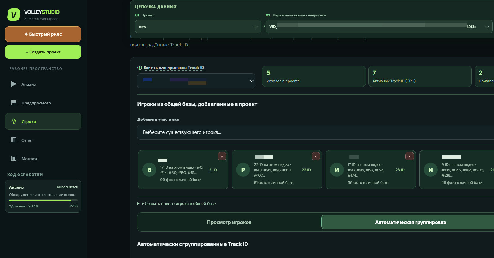
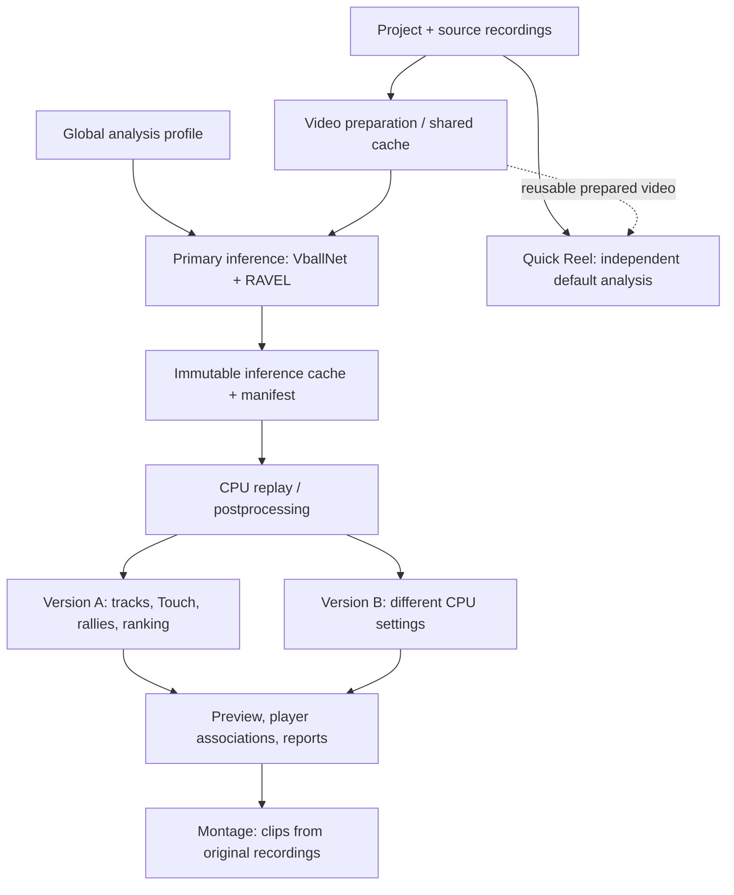
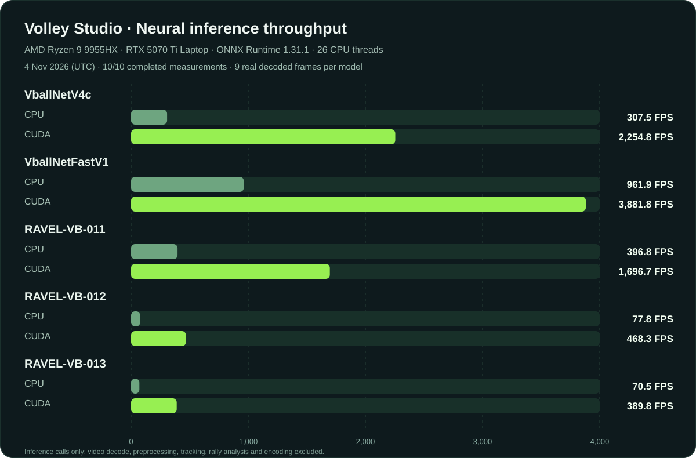
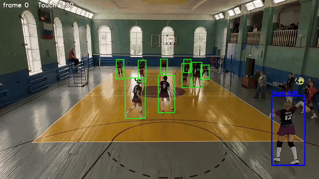

# Volley Studio — volleyball analysis and automatic reels

**Volley Studio** is a local, browser-based workspace built on top of the
[Fast Volleyball Tracking Inference](https://github.com/asigatchov/fast-volleyball-tracking-inference)
pipeline. It turns amateur volleyball recordings into reusable match analyses,
player-linked statistics, rally previews and original-quality 9:16 reels.



*Actual Studio interface, captured on 6 November 2026. Private player names and source filenames are redacted.*

**Rust-миграция: 54/85; следующий 55/85 (плановый объём).** [Полная карта 85 этапов](docs/RUST_ROADMAP.md) · [Правила без дублирования](docs/RUST_ARCHITECTURE.md) · [Журнал миграции](docs/RUST_MIGRATION.md). Это развитие отдельной Rust-ветки; оригинальная Python Studio остаётся рабочей, а счётчик этапов не означает 53/85 готовности приложения.

## Features

- Multi-video projects with reusable prepared H.264 analysis copies, shared across projects without changing the source.
- Global analysis presets, including an amateur-match / ReID profile, plus project-specific saved runs.
- VballNet ball inference and RAVEL-013 player, ball and per-frame Touch predictions.
- A separate **CPU postprocessing/replay** layer for ball filtering, tracks, Touch peaks, rally reconstruction and player continuity; tuning it normally does not repeat the expensive neural inference.
- Player Track ID grouping using appearance/ReID features, suggested links to the player library, confidence thresholds and manual confirmation.
- Preview, timeline, reports and editing linked to a specific analysis/postprocessing version.
- Manual or automatic reel selection, vertical framing, original-source exports and optional audio.
- A separate **Quick Reel** workflow: fresh analysis with default settings, while compatible already-prepared input video can be reused.

## Launch locally

From Windows, double-click [start-volley-ui.cmd](start-volley-ui.cmd). From WSL Ubuntu
at the repository root:

```bash
.venv/bin/python -m scripts.volleyball_ui
```

Open **http://127.0.0.1:8765** in a browser. Double-clicking `start-volley-ui.cmd` again **reuses the existing server** rather than launching a duplicate. To perform a complete restart, use the **↻ Перезапустить студию** button in the left sidebar (or `start-volley-ui.cmd /restart`). Both use one server-side restart endpoint: the Python interpreter is replaced in-place, port 8765 remains the single listener, and the browser refreshes only after the new instance becomes healthy. Active analysis, CPU reprocessing, and montage jobs block restarts; the launcher never force-kills them or starts a second instance after an unconfirmed restart. `scripts/volleyball_ui/ensure-fresh.ps1` implements the shared launcher health check and safe restart logic. Normal F5 does not restart the server; cached results remain available.

For setup and the original CLI,
see [Installation](#installation) and [Quick start](#quick-start-tested) below.
For the interface, see the [Russian UI guide](docs/VOLLEY_STUDIO_UI.md).

## Contributing and local checks

All changes go through a pull request into `master`. The development process,
local test commands, regression scenarios and quality-evaluation policy are in
[Development workflow](docs/DEVELOPMENT_WORKFLOW.md),
[Testing stages](docs/TESTING.md), and
[Quality evidence](docs/quality/README.md). GitHub Actions are removed: run
`python -m scripts.ci.run_checks` before submitting a PR, and
`python -m scripts.ci.run_checks --full` for full regression checks.
Golden CPU defaults still require real annotated-match evidence.

## Studio architecture

The key design rule is **infer once, interpret many times**. Model execution
is the expensive stage; interpreting cached predictions, tweaking thresholds
and re-linking players are independent, versioned CPU operations.
The immutable source-data contract and default CPU interpretation are documented
in [the architecture decision](docs/ARCHITECTURE_INFERENCE_POSTPROCESSING.md).



The persisted relationship is:

```text
Global analysis profiles (shared across all projects)
Project
  ├── source videos / project settings / selected players
  └── video
      └── primary analysis run (profile snapshot, range, GPU inference cache)
          ├── original postprocessing result
          ├── CPU postprocessing version A
          └── CPU postprocessing version B
              └── preview → player linking → report → montage
```

| Stage | Main implementation | Reuses |
| --- | --- | --- |
| Import and video preparation | `scripts/volleyball_ui/prepared_videos.py`, `scripts/volleyball_studio/video_inputs.py` | Original files and compatible prepared videos in `results/prepared/` |
| Neural inference (GPU/CPU backend) | `src/inference_onnx_seq_gray_v2.py`, `src/inference_player_ball_openvino.py`, `scripts/run_project_analysis.py` | VballNet + RAVEL detections and scores, saved as versioned inference inputs |
| CPU replay and event interpretation | `scripts/run_project_reprocess.py`, `scripts/volleyball_studio/reprocess.py`, `scripts/volleyball_studio/touch_peaks.py` | Saved candidates/scores, independent `postprocessing/<version-id>/` outputs |
| Player identity association | `scripts/volleyball_ui/player_identity_groups.py`, `player_amateur_match.py`, `player_reference_matching.py` | Track ID groups, reference photos and configurable matching confidence |
| Browser interface and montage | `scripts/volleyball_ui/server.py`, `static/`, `montage_runner.py`, `src/make_reels.py` | Chosen postprocessing version and **original** media for final encoding |

RAVEL-013's per-frame Touch probabilities are retained and can feed
peak selection and spatial validation in `ravel-touch` / `combined` modes.
The CPU modes are `baseline`, `ravel-touch`, `ravel-geometry` and `combined`.
An inferred Touch is a hypothesis, **not** independently verified contact.
Rally boundaries are heuristic and can be imperfect if ball observations are
missing. New inference is still needed when changing the model, frame sampling
or thresholds below the retained candidate floor.

Project runs and postprocessing versions are isolated; shared profiles and
prepared videos do not imply shared project results. Saved athlete references
can be reused, while manual associations remain authoritative. Automatic
identity linking has conservative similarity and ambiguity checks.

Additional details: [inference vs CPU replay](docs/inference-postprocessing.md),
[architecture audit](docs/refactor-audit-2026-11-05.md).

## Measured model performance



**Latest complete local series: 4 November 2026 (UTC), ID `60ac909865be`.**
Hardware: AMD Ryzen 9 9955HX, NVIDIA RTX 5070 Ti Laptop GPU,
26 ONNX CPU threads, ONNX Runtime 1.31.1. All **10/10** model/device
measurements completed.

| Model | ONNX CPU FPS | ONNX CUDA FPS |
| --- | ---: | ---: |
| VballNetV4c | 307.5 | 2,254.8 |
| VballNetFastV1 | 961.9 | 3,881.8 |
| RAVEL-VB-011 | 396.8 | 1,696.7 |
| RAVEL-VB-012 | 77.8 | 468.3 |
| **RAVEL-VB-013** | **70.6** | **389.8** |

**Method:** Each model receives nine actual decoded video frames converted to
its input resolution *before* timing. CPU/CUDA runs are sequential (three
warmups, 12 synchronous inference calls per repeat, two repeats).
FPS is nine frames divided by the median model-call latency. This is
**inference-only throughput, not end-to-end video FPS or model accuracy**:
video decoding, input conversion, postprocessing, tracking, rally analysis
and encoding are excluded. Different model input resolutions also make
throughput alone insufficient to compare detection quality.

To benchmark a project: `uv run scripts/benchmark_project.py --project-id <project-id>`.
The [3 November benchmark chart](docs/images/benchmark-inference-fps.png)
is retained for historical comparison. The legacy accuracy benchmark farther
below uses a *different machine and methodology* and must not be compared
directly with these numbers.

## Live demos
- VPS: [Tracking - ball](https://demo.vb-ai.ru/)
- Hugging Face: [Tracking - ball](https://huggingface.co/spaces/asigatchov/volleyball-tracking)

High-speed pipeline for volleyball ball detection, rally extraction, and automatic generation of 9:16 reels.

[](https://youtu.be/1ha7WU9sH2k)

## Standalone ball-tracking CLI (legacy pipeline)

The steps below document the original ball-only CLI, **not** the complete Volley Studio project workflow described above.

1. `src/inference_onnx_seq_gray_v2.py` -> detects ball and writes `ball.csv` (and optional `predict.mp4`).
2. `src/track_calculator.py` -> converts `ball.csv` to rally tracks (`track_*.json`).
3. `src/track_processor.py` -> creates combined video (`combined.mp4`) or split rally clips.
4. `src/make_reels.py` -> creates vertical 9:16 reels centered around ball trajectory.

`src/track_calculator_with_court.py` is the court-aware variant of step 2. Given
player detections it also finds ball touches with their technique and tells a
rally apart from a ball handed over for the next serve - see
[PLAYER_CONTACTS.md](PLAYER_CONTACTS.md).

## Installation
```bash
git clone https://github.com/Amazomic/fast-volleyball-tracking-inference.git
cd fast-volleyball-tracking-inference
uv sync
```

The pipeline itself needs nothing beyond that - `--visualize` works on the base install,
since `opencv-python` already ships the GUI backend. The `dev` extra adds `matplotlib`
for the diagnostic plots in `src/test_models.py` and `src/serv_det*.py`, and `pytest`
to run the suite under `tests/`:
```bash
uv sync --extra dev
```

## Quick start (tested)
Example input:
- video: `examples/gtu_20250316_002.mp4`
- model: `models/VballNetFastV1_seq9_grayscale_233_h288_w512.onnx`

```bash
VIDEO="examples/gtu_20250316_002.mp4"
MODEL="models/VballNetFastV1_seq9_grayscale_233_h288_w512.onnx"
OUT="output"

# 1) Detection -> ball.csv
uv run src/inference_onnx_seq_gray_v2.py \
  --video_path "$VIDEO" \
  --model_path "$MODEL" \
  --output_dir "$OUT" \
  --only_csv

# 2) Tracks from CSV -> track_*.json
uv run src/track_calculator.py \
  --csv_path "$OUT/gtu_20250316_002/ball.csv" \
  --output_dir "$OUT"

# 3) Optional: combined horizontal rally video
uv run src/track_processor.py \
  --video_path "$VIDEO" \
  --output_dir "$OUT"

# 4) Vertical reels from tracks
uv run src/make_reels.py \
  --video_path "$VIDEO" \
  --json_dir "$OUT/gtu_20250316_002/tracks" \
  --output_dir "$OUT"
```

## Output structure
```text
output/gtu_20250316_002/
├── ball.csv
├── tracks/
│   └── track_0000.json
├── combined.mp4
└── reels/
    └── reel_gtu_20250316_002_0000.mp4
```

## Key CLI options

### `src/inference_onnx_seq_gray_v2.py`
- `--confidence_threshold` - heatmap threshold for detection postprocess.
- `--visualize` - show live preview.
- `--only_csv` - skip writing output video.

### `src/track_calculator.py`
- `--court_json_path` - optional court annotation JSON. If passed, net/court-aware rally filtering is enabled.
- `--fps`, `--max_distance`, `--min_duration_sec` - main tracking/filtering params.

### `src/track_processor.py`
- By default, only tracks with `rally_classification.is_rally=true` are exported;
  `not_rally` and unclassified tracks are skipped.
- `--include-not-rally` - include all tracks for diagnostic exports.
- `--padding` - seconds to add before and after every rally in the exported video.
- `--output_dir` - auto-resolves `tracks` and `combined.mp4` by video basename.
- `--json_dir` - explicit tracks folder.
- `--split_dir` - export each rally into a separate clip.

### `src/show_rally.py`
Interactive review of tracks over the source video:
```bash
uv run src/show_rally.py output/beach-mixt/tracks /path/to/video.mp4 \
  --players_json_path ../uploads/mix/beach-mixt_predictions.json \
  --court_json_path ../uploads/mix/beach-mixt_court.json
```
- `space` play/pause, `a`/`d` step one frame, `w`/`s` jump 15 frames,
  `n`/`p` next/previous track, `v` switches the main view between video and schematic,
  `b` toggles the left box-only panel (court, player boxes and ball),
  `t` ball path, `h` help, `q` quit.
- Player and court JSON files are auto-detected next to `<clip>/tracks` by the
  `<clip>_predict.json` and `<clip>_court.json` names. Legacy `<clip>_coort.json`
  files are also recognized; explicit paths override auto-detection.
- `--track N` - start from a given track, `--snapshot FILE` - render one frame and exit
  (works without a display).

### `src/make_reels.py`
- `--smoothing {none,moving_avg,savitzky_golay,kalman}` - smooth camera motion.
- `--interpolation {hold,linear}` - fill missing tracked-ball coordinates.
- `--margin` - lead offset in movement direction.
- `--padding` - seconds added before the start and after the end of each rally (default 0.33).
- `--zoom-max 1.35` - speed-adaptive zoom on portrait sources (allowed 1–2).
  The crop follows ball X **and Y**; quick movement widens the view and
  quieter movement zooms in. Use `--zoom-max 1` for no zoom.
  The crop remains inside the original video frame and exports 9:16.

The fork's montage now reconstructs common rally intervals in
`scripts/rally_boundaries.py`, reused by Results and full-rally montage.
Very short VballNet track dropouts can be joined; strongly classified
technical returns or a confirmed new serve prevent accidental joining.
These boundaries are **heuristic**. The pipeline does not have validated
serve/point annotations for every rally, so it cannot guarantee exact
serve-to-point edits. Vertical export receives one combined track payload
per chosen rally instead of trimming each separate ball track.


## OpenVino runtime
### `uv run src/inference_openvino_seq_gray_v2.py`
- `--model_xml ./ov/VballNetV4c_seq9_grayscale_20260908_213829.xml`
- `--video_path ./examples/gtu_20250316_002.mp4`
- `--only_csv`
- `--output_dir ./demo-result/`

### Players + ball + Touch: `src/inference_player_ball_openvino.py`
RAVEL releases predict player boxes / track associations and, when supported by
the release, ball locations, head points and actions. RAVEL-VB-013 outputs
`Touch` / `none` classifications per detected player, **not rally boundaries**.
The tool writes a `ravel-vb-predictions-v1` JSON consumed by the UI and
`--players_json_path` tools.

```bash
# RAVEL-VB-013: ONNX Runtime CUDA, 640x360 RGB, 9-frame clips, Touch scores
uv run src/inference_player_ball_openvino.py ./examples/gtu_20250316_002.mp4 \
  --model ./models/RAVEL-VB-013-9f.onnx \
  --backend onnx-cuda --device GPU \
  --output ./demo-result/players.json

# RAVEL-VB-012: OpenVINO example
uv run src/inference_player_ball_openvino.py ./examples/gtu_20250316_002.mp4 \
  --model ./ov/RAVEL-VB-012-9f.xml --output ./demo-result/
```
- `--output` - JSON file or directory (a directory gets `<video>_predictions.json`).
- `--output-video` - annotated video; `--show` - live window (`Esc`/`q` to stop).
- `--score-threshold 0.35` / `--close-threshold 0.20` / `--hysteresis-frames 2` -
  player open/close thresholds and how many frames a lost player is held.
- `--ball-threshold 0.35`, `--head-threshold 0.30` - thresholds for
  model-provided ball and head detections.
- `--action-threshold 0.35` - threshold for RAVEL-013 Touch classification;
  actions below the threshold are not retained as final Touch predictions.
- `--stride 9` - clip step; `--frame-step 2` feeds every second frame (faster, coarser).
- `--device {CPU,GPU,AUTO}`, `--num-threads N`; ONNX CUDA uses
  `--backend onnx-cuda --device GPU`.
- Input size, channels and clip length are read from the model's sidecar `.json`.
  ONNX models include `models/RAVEL-VB-011-9f.onnx`,
  `models/RAVEL-VB-012-9f.onnx`, and `models/RAVEL-VB-013-9f.onnx`
  (with corresponding `.json` metadata).

## Available ONNX models
Benchmark setup:
- runner: `scripts/eval_ov_models.py`, which reuses the decode path of `src/inference_openvino_seq_gray_v2.py`
- dataset: `beach-test-raw` - 3 clips, 886 labelled frames, 1280x720 and 1920x1080
- runtime: OpenVINO on CPU (Intel Core i5-10400F, 12 threads)
- a detection counts as a hit when it lands within 9 px of the label at 1920 frame width; the tolerance is scaled to each clip's resolution, so the 720p clips are judged at 6 px
- `Precision`, `Recall` and `F1` are computed over those hits; frames where label and prediction agree the ball is invisible count as true negatives
- `CPU FPS` times the inference call alone, not the end-to-end pipeline. `scripts/bench_inference_fps.py` feeds the model a synthetic random tensor of its own
  input shape (`[1, seq, H, W]`, float32), runs 10 warm-up inferences and then times 60 more. One call decodes `seq` frames at once, so a run scores `seq / median(latency)`.
  The model is reloaded for each of the 3 repeats, because OpenVINO lays the network out across threads differently from load to load, and the table reports the median of
  those repeats. Video decode, the grayscale+resize preprocess and the heatmap/grid postprocess are all excluded.

| Model | F1 | Precision | Recall | CPU FPS |
| --- | ---: | ---: | ---: | ---: |
| `VballNetV4c_seq9_grayscale_20260908_213829.onnx` | 0.902 | 0.900 | 0.904 | 149.6 |
| `VballNetGridV2b_seq9_grayscale_20260909_001145.onnx` | 0.892 | 0.874 | 0.910 | 122.9 |
| `VballNetGridV3_seq9_grayscale_20260908_225156.onnx` | 0.867 | 0.870 | 0.863 | 229.3 |
| `VballNetFastV1_seq9_grayscale_233_h288_w512.onnx` | 0.799 | 0.778 | 0.822 | 1140.0 |

Reproduce the speed column with:
```bash
uv run scripts/bench_inference_fps.py models/*.onnx
```
Expect the result to move by 3-4% between invocations. A full pipeline run is slower than the number above, since inference then shares the
same cores with video decode - roughly 10% off for `VballNetGridV3` on this machine, and more on the lighter models where decode weighs relatively more.

Earlier checkpoints and their OpenVINO IR counterparts live in `old_models/onnx/` and
`old_models/ov/`; they are kept for reference and are not benchmarked here.

## Notes
- `onnxruntime` can run on CPU if CUDA provider is unavailable.
- All scripts support `--help` and can be launched through `uv run`.
