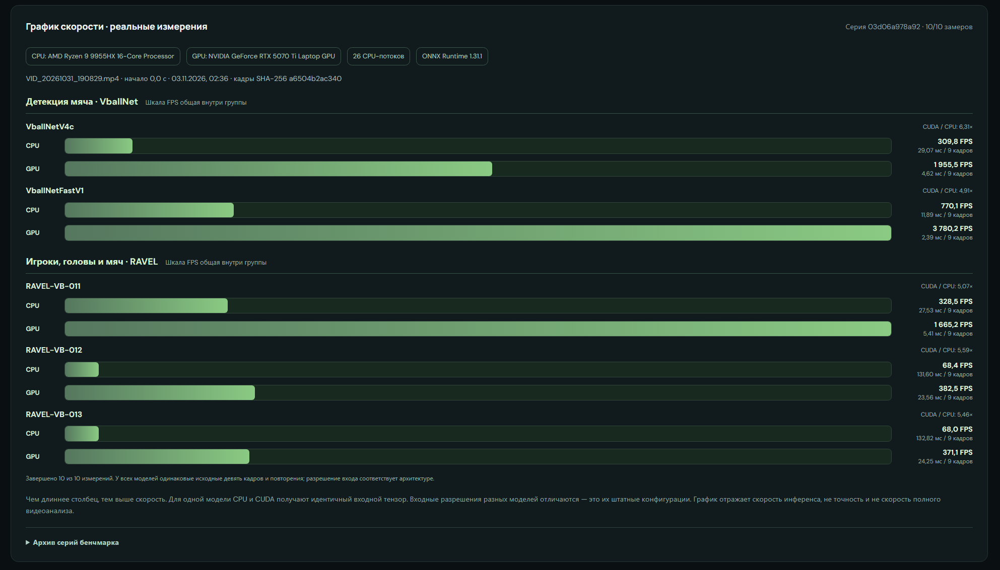
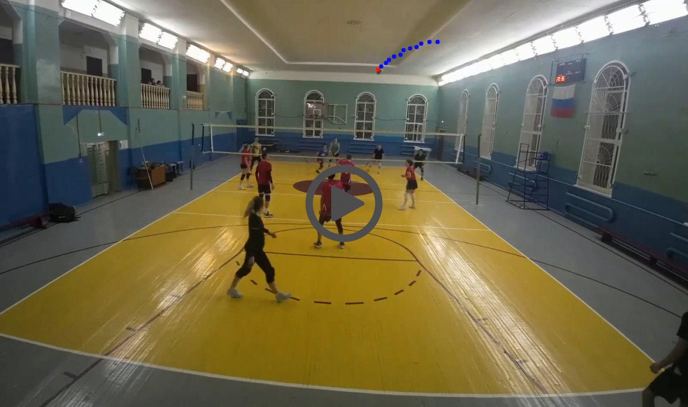

# Fast Volleyball Ball Tracking → Volley Studio

## Volley Studio — local volleyball analysis and reels

This fork provides a browser-based workspace for **multi-video projects**, reusable **analysis profiles**, player detection and association, ball trajectories, touch/event previews, rally timelines, manual/automatic reel selection, vertical ball-following crops, and progress reporting.

- Windows + WSL Ubuntu: double-click `start-volley-ui.cmd`.
- WSL terminal from the repository root: `.venv/bin/python -m scripts.volleyball_ui`.
- Open **http://127.0.0.1:8765**.
- Source recordings: `project/`; project-scoped runs and montage results: `results/projects/`; reusable prepared videos: `results/prepared/`.
- [Detailed UI guide (Russian)](docs/VOLLEY_STUDIO_UI.md).

### How the current Studio pipeline works

1. **Import / preparation:** source recordings remain unchanged. FFmpeg automatically prepares a reusable H.264 / 30 FPS analysis copy in `results/prepared/`, shared between projects when the source identity and normalization parameters match. This is a separate, visible stage.
2. **Neural inference:** VballNet (ball) produces `ball.csv`; RAVEL (players, its own ball detections, and—on RAVEL-013—Touch predictions) produces `players.json`. Model/backend selection belongs to the analysis profile.
3. **Postprocessing:** `src/track_calculator_with_court.py` builds ball tracks, estimates geometric contacts and heuristically classifies rally-like intervals; `scripts/rally_boundaries.py` reconstructs groups and safe context. **RAVEL-013's direct Touch scores are currently a separate preview, not the input to rally classification.**
4. **Results / montage:** each completed analysis has its own project-linked cache and ranking. Montage selects reconstructed rallies using these saved results and cuts the **original recording** at corresponding timestamps. Ball-following reels additionally use the saved track coordinates.

Rally boundaries are **heuristic, not verified serve-to-point annotations**; a lost ball track can still truncate a detected interval. The application runs locally and does not upload videos to an external service. Athlete identity links are user-reviewed rather than verified by the detector.

## Measured inference speed (CPU vs CUDA)



Real nine-frame input benchmark from the Studio UI, recorded **3 November 2026** (series `03d06a978a92`; 10/10 CPU/GPU measurements). Hardware: **AMD Ryzen 9 9955HX**, **NVIDIA GeForce RTX 5070 Ti Laptop GPU**, **26 CPU threads**, **ONNX Runtime 1.31.1**.

| Model | CPU FPS | CUDA FPS |
| --- | ---: | ---: |
| VballNetV4c | 309.8 | 1,955.5 |
| VballNetFastV1 | 770.1 | 3,780.2 |
| RAVEL-VB-011 | 328.5 | 1,665.2 |
| RAVEL-VB-012 | 68.4 | 382.5 |
| **RAVEL-VB-013** | **68.0** | **371.1** |

These are **inference-only throughput figures**, not real-world full-video processing speed or detection accuracy. Each model uses the same nine decoded source frames, resized and converted to that model's required input shape **before timing**; CPU and CUDA runs are sequential. Throughput is calculated as 9 frames divided by median synchronous inference latency. Video decoding, preprocessing, tracking, rally classification, rendering, and encoding are excluded. Different models have different native input resolutions.

To reproduce on a local project: `uv run scripts/benchmark_project.py --project-id <project-id>`. The older accuracy/CPU-speed table below uses a **different machine and benchmark**, and should not be compared directly.

## Live demos
- VPS: [Tracking - ball](https://demo.vb-ai.ru/)
- Hugging Face: [Tracking - ball](https://huggingface.co/spaces/asigatchov/volleyball-tracking)

High-speed pipeline for volleyball ball detection, rally extraction, and automatic generation of 9:16 reels.

[](https://www.youtube.com/watch?v=TBDrTMFMoFA)

## Standalone ball-tracking CLI (legacy pipeline)

The steps below document the original ball-only CLI, **not** the complete Volley Studio project workflow described above.

1. `src/inference_onnx_seq_gray_v2.py` -> detects ball and writes `ball.csv` (and optional `predict.mp4`).
2. `src/track_calculator.py` -> converts `ball.csv` to rally tracks (`track_*.json`).
3. `src/track_processor.py` -> creates combined video (`combined.mp4`) or split rally clips.
4. `src/make_reels.py` -> creates vertical 9:16 reels centered around ball trajectory.

`src/track_calculator_with_court.py` is the court-aware variant of step 2. Given
player detections it also finds ball touches with their technique and tells a
rally apart from a ball handed over for the next serve - see
[PLAYER_CONTACTS.md](PLAYER_CONTACTS.md).

## Installation
```bash
git clone https://github.com/Amazomic/fast-volleyball-tracking-inference.git
cd fast-volleyball-tracking-inference
uv sync
```

The pipeline itself needs nothing beyond that - `--visualize` works on the base install,
since `opencv-python` already ships the GUI backend. The `dev` extra adds `matplotlib`
for the diagnostic plots in `src/test_models.py` and `src/serv_det*.py`, and `pytest`
to run the suite under `tests/`:
```bash
uv sync --extra dev
```

## Quick start (tested)
Example input:
- video: `examples/gtu_20250316_002.mp4`
- model: `models/VballNetFastV1_seq9_grayscale_233_h288_w512.onnx`

```bash
VIDEO="examples/gtu_20250316_002.mp4"
MODEL="models/VballNetFastV1_seq9_grayscale_233_h288_w512.onnx"
OUT="output"

# 1) Detection -> ball.csv
uv run src/inference_onnx_seq_gray_v2.py \
  --video_path "$VIDEO" \
  --model_path "$MODEL" \
  --output_dir "$OUT" \
  --only_csv

# 2) Tracks from CSV -> track_*.json
uv run src/track_calculator.py \
  --csv_path "$OUT/gtu_20250316_002/ball.csv" \
  --output_dir "$OUT"

# 3) Optional: combined horizontal rally video
uv run src/track_processor.py \
  --video_path "$VIDEO" \
  --output_dir "$OUT"

# 4) Vertical reels from tracks
uv run src/make_reels.py \
  --video_path "$VIDEO" \
  --json_dir "$OUT/gtu_20250316_002/tracks" \
  --output_dir "$OUT"
```

## Output structure
```text
output/gtu_20250316_002/
├── ball.csv
├── tracks/
│   └── track_0000.json
├── combined.mp4
└── reels/
    └── reel_gtu_20250316_002_0000.mp4
```

## Key CLI options

### `src/inference_onnx_seq_gray_v2.py`
- `--confidence_threshold` - heatmap threshold for detection postprocess.
- `--visualize` - show live preview.
- `--only_csv` - skip writing output video.

### `src/track_calculator.py`
- `--court_json_path` - optional court annotation JSON. If passed, net/court-aware rally filtering is enabled.
- `--fps`, `--max_distance`, `--min_duration_sec` - main tracking/filtering params.

### `src/track_processor.py`
- By default, only tracks with `rally_classification.is_rally=true` are exported;
  `not_rally` and unclassified tracks are skipped.
- `--include-not-rally` - include all tracks for diagnostic exports.
- `--padding` - seconds to add before and after every rally in the exported video.
- `--output_dir` - auto-resolves `tracks` and `combined.mp4` by video basename.
- `--json_dir` - explicit tracks folder.
- `--split_dir` - export each rally into a separate clip.

### `src/show_rally.py`
Interactive review of tracks over the source video:
```bash
uv run src/show_rally.py output/beach-mixt/tracks /path/to/video.mp4 \
  --players_json_path ../uploads/mix/beach-mixt_predictions.json \
  --court_json_path ../uploads/mix/beach-mixt_court.json
```
- `space` play/pause, `a`/`d` step one frame, `w`/`s` jump 15 frames,
  `n`/`p` next/previous track, `v` switches the main view between video and schematic,
  `b` toggles the left box-only panel (court, player boxes and ball),
  `t` ball path, `h` help, `q` quit.
- Player and court JSON files are auto-detected next to `<clip>/tracks` by the
  `<clip>_predict.json` and `<clip>_court.json` names. Legacy `<clip>_coort.json`
  files are also recognized; explicit paths override auto-detection.
- `--track N` - start from a given track, `--snapshot FILE` - render one frame and exit
  (works without a display).

### `src/make_reels.py`
- `--smoothing {none,moving_avg,savitzky_golay,kalman}` - smooth camera motion.
- `--interpolation {hold,linear}` - fill missing tracked-ball coordinates.
- `--margin` - lead offset in movement direction.
- `--padding` - seconds added before the start and after the end of each rally (default 0.33).
- `--zoom-max 1.35` - speed-adaptive zoom on portrait sources (allowed 1–2).
  The crop follows ball X **and Y**; quick movement widens the view and
  quieter movement zooms in. Use `--zoom-max 1` for no zoom.
  The crop remains inside the original video frame and exports 9:16.

The fork's montage now reconstructs common rally intervals in
`scripts/rally_boundaries.py`, reused by Results and full-rally montage.
Very short VballNet track dropouts can be joined; strongly classified
technical returns or a confirmed new serve prevent accidental joining.
These boundaries are **heuristic**. The pipeline does not have validated
serve/point annotations for every rally, so it cannot guarantee exact
serve-to-point edits. Vertical export receives one combined track payload
per chosen rally instead of trimming each separate ball track.


## OpenVino runtime
### `uv run src/inference_openvino_seq_gray_v2.py`
- `--model_xml ./ov/VballNetV4c_seq9_grayscale_20260908_213829.xml`
- `--video_path ./examples/gtu_20250316_002.mp4`
- `--only_csv`
- `--output_dir ./demo-result/`

### Players + ball + Touch: `src/inference_player_ball_openvino.py`
RAVEL releases predict player boxes / track associations and, when supported by
the release, ball locations, head points and actions. RAVEL-VB-013 outputs
`Touch` / `none` classifications per detected player, **not rally boundaries**.
The tool writes a `ravel-vb-predictions-v1` JSON consumed by the UI and
`--players_json_path` tools.

```bash
# RAVEL-VB-013: ONNX Runtime CUDA, 640x360 RGB, 9-frame clips, Touch scores
uv run src/inference_player_ball_openvino.py ./examples/gtu_20250316_002.mp4 \
  --model ./models/RAVEL-VB-013-9f.onnx \
  --backend onnx-cuda --device GPU \
  --output ./demo-result/players.json

# RAVEL-VB-012: OpenVINO example
uv run src/inference_player_ball_openvino.py ./examples/gtu_20250316_002.mp4 \
  --model ./ov/RAVEL-VB-012-9f.xml --output ./demo-result/
```
- `--output` - JSON file or directory (a directory gets `<video>_predictions.json`).
- `--output-video` - annotated video; `--show` - live window (`Esc`/`q` to stop).
- `--score-threshold 0.35` / `--close-threshold 0.20` / `--hysteresis-frames 2` -
  player open/close thresholds and how many frames a lost player is held.
- `--ball-threshold 0.35`, `--head-threshold 0.30` - thresholds for
  model-provided ball and head detections.
- `--action-threshold 0.35` - threshold for RAVEL-013 Touch classification;
  actions below the threshold are not retained as final Touch predictions.
- `--stride 9` - clip step; `--frame-step 2` feeds every second frame (faster, coarser).
- `--device {CPU,GPU,AUTO}`, `--num-threads N`; ONNX CUDA uses
  `--backend onnx-cuda --device GPU`.
- Input size, channels and clip length are read from the model's sidecar `.json`.
  ONNX models include `models/RAVEL-VB-011-9f.onnx`,
  `models/RAVEL-VB-012-9f.onnx`, and `models/RAVEL-VB-013-9f.onnx`
  (with corresponding `.json` metadata).

## Available ONNX models
Benchmark setup:
- runner: `scripts/eval_ov_models.py`, which reuses the decode path of `src/inference_openvino_seq_gray_v2.py`
- dataset: `beach-test-raw` - 3 clips, 886 labelled frames, 1280x720 and 1920x1080
- runtime: OpenVINO on CPU (Intel Core i5-10400F, 12 threads)
- a detection counts as a hit when it lands within 9 px of the label at 1920 frame width; the tolerance is scaled to each clip's resolution, so the 720p clips are judged at 6 px
- `Precision`, `Recall` and `F1` are computed over those hits; frames where label and prediction agree the ball is invisible count as true negatives
- `CPU FPS` times the inference call alone, not the end-to-end pipeline. `scripts/bench_inference_fps.py` feeds the model a synthetic random tensor of its own
  input shape (`[1, seq, H, W]`, float32), runs 10 warm-up inferences and then times 60 more. One call decodes `seq` frames at once, so a run scores `seq / median(latency)`.
  The model is reloaded for each of the 3 repeats, because OpenVINO lays the network out across threads differently from load to load, and the table reports the median of
  those repeats. Video decode, the grayscale+resize preprocess and the heatmap/grid postprocess are all excluded.

| Model | F1 | Precision | Recall | CPU FPS |
| --- | ---: | ---: | ---: | ---: |
| `VballNetV4c_seq9_grayscale_20260908_213829.onnx` | 0.902 | 0.900 | 0.904 | 149.6 |
| `VballNetGridV2b_seq9_grayscale_20260909_001145.onnx` | 0.892 | 0.874 | 0.910 | 122.9 |
| `VballNetGridV3_seq9_grayscale_20260908_225156.onnx` | 0.867 | 0.870 | 0.863 | 229.3 |
| `VballNetFastV1_seq9_grayscale_233_h288_w512.onnx` | 0.799 | 0.778 | 0.822 | 1140.0 |

Reproduce the speed column with:
```bash
uv run scripts/bench_inference_fps.py models/*.onnx
```
Expect the result to move by 3-4% between invocations. A full pipeline run is slower than the number above, since inference then shares the
same cores with video decode - roughly 10% off for `VballNetGridV3` on this machine, and more on the lighter models where decode weighs relatively more.

Earlier checkpoints and their OpenVINO IR counterparts live in `old_models/onnx/` and
`old_models/ov/`; they are kept for reference and are not benchmarked here.

## Notes
- `onnxruntime` can run on CPU if CUDA provider is unavailable.
- All scripts support `--help` and can be launched through `uv run`.
